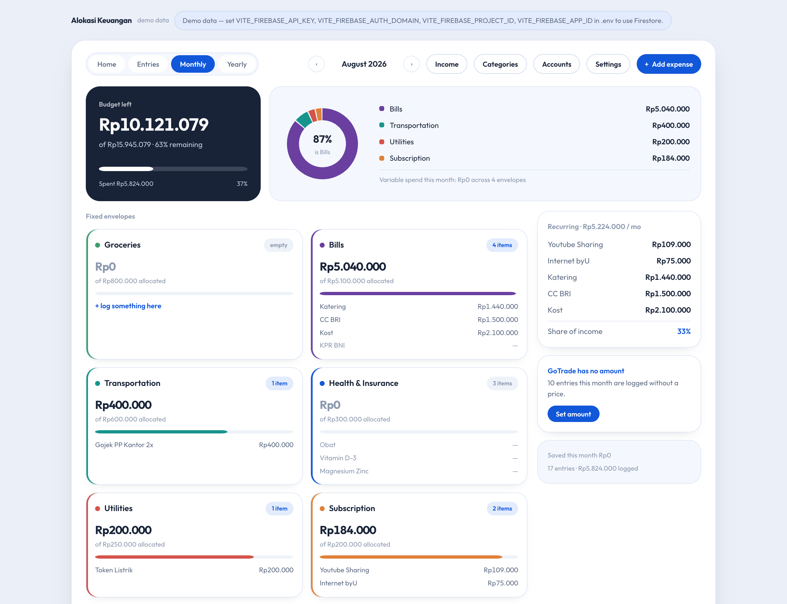
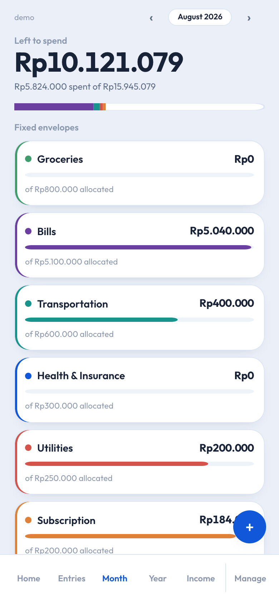

# expense-tracker

A personal expense tracker with two front ends — a mobile webview and a desktop
dashboard — sharing one Firebase backend, one package of business logic and one
design system.

The UI implements the Claude Design prototype
[`Expense Dashboard Prototype.dc.html`](https://claude.ai/design/p/21aceca5-bde0-48a3-8290-d22e161276bc?file=Expense+Dashboard+Prototype.dc.html):
its desktop layout is `packages/desktop`, its phone layout is
`packages/mobile-webview`.

## Screenshots

The desktop dashboard on its Monthly tab — budget left, where the month went,
and one envelope per category:



The same month in the mobile webview:



Both are the built-in seed dataset running with no Firebase config — what the
Getting started steps below give you before any `.env` exists, banner and all.
The seed month is **August 2026**; the apps open on the current month, so step
back with **‹** to land on the data above.

```
expense-tracker/
├── packages/
│   ├── shared/              # Firebase config, TS types, business logic, store
│   ├── design-system/       # Tokens, CSS and the React components both apps share
│   ├── mobile-webview/      # Mobile-facing web app
│   └── desktop/             # Desktop dashboard app
├── firebase/
│   ├── firestore.rules
│   └── firestore.indexes.json
├── docs/screenshots/        # Images used by this README
├── package.json             # workspace root
├── pnpm-workspace.yaml
├── .env.example             # Firebase config keys — .env is gitignored
└── README.md
```

## Getting started

```bash
pnpm install
pnpm build          # shared and design-system first, then both apps
pnpm dev:desktop    # http://localhost:5173
pnpm dev:mobile     # http://localhost:5174
```

`pnpm build` is not optional before the first `dev`: `@expense-tracker/shared`
and `@expense-tracker/design-system` resolve to their `dist/`, so the apps have
nothing to import until those two are compiled. `pnpm -r` walks the workspace
dependency graph, so one command does them in the right order.

To work on the components in isolation:

```bash
pnpm --filter @expense-tracker/design-system storybook   # http://localhost:6006
```

`pnpm typecheck` is the correctness check across all four packages. There is no
lint script and no test runner configured.

Both apps run immediately with no Firebase project: with no config in the
environment they fall back to an in-memory seed dataset (see
`packages/shared/src/data/seedData.ts`), skip the login gate and say so in the
header.

## Firebase setup

1. Copy the template and fill it in from **Firebase console → Project settings
   → Your apps → SDK setup and configuration**:

   ```bash
   cp .env.example .env
   ```

   One `.env` at the workspace root serves both apps — each `vite.config.ts`
   sets `envDir: '../..'`.

2. Enable **Email/Password** (and optionally **Google**) under Authentication →
   Sign-in method. Both apps open on a login screen; every identity is a real
   account, so `request.auth.uid` is populated and the security rules apply.
   There is no anonymous sign-in — it was removed once the login gate landed,
   because signing in automatically means the gate never renders.

   Add `localhost` under Authentication → Settings → Authorized domains, or
   Google Sign-in's popup is refused in local development. (Email/Password is
   unaffected; it doesn't use OAuth redirects.) The `auth.authorizedDomains`
   list in `firebase.json` mirrors what is live rather than driving it —
   `deploy --only auth` applies the `providers` block and ignores that field,
   so domains are added in the console.

3. Create the Firestore database **from the Firebase console** — Firestore →
   Create database — with database ID `personal-finance-dashboard-db` and
   location `asia-southeast2`. Not `(default)`, which lands in `nam5` (US), and
   not via the CLI or the Firebase MCP tools: a database created through the
   API silently refused to enforce the rules released to it, failing every
   authenticated request with `PERMISSION_DENIED`. See CLAUDE.md for the full
   symptom.

4. Deploy the rules and indexes:

   ```bash
   npx firebase-tools deploy --only firestore:rules,firestore:indexes
   ```

   The target database comes from `firebase.json`; `deploy` has no
   `--database` flag.

The `VITE_FIREBASE_*` values are inlined into the client bundle by design.
Firebase web config is public identification, not a secret — access control is
enforced entirely by `firebase/firestore.rules`. `.env` is gitignored;
`.env.example` holds placeholders only.

## What's on screen

Both apps open on **Home**, a dashboard of cards you choose yourself, and both
scope everything to one tracking period, stepped with **‹** and **›**.

| | Desktop | Mobile |
| --- | --- | --- |
| Period views | Home · Entries · Monthly · Yearly, in a segmented control | Home · Entries · Month · Year, in the bottom nav |
| Income | **Income** button in the toolbar, opening a page of its own | **Income** tab in the bottom nav |
| Managers | **Categories**, **Accounts**, **Settings** buttons | behind one **Manage** button |
| Add an expense | **+ Add expense** in the toolbar | a floating **+** above the nav bar |

**Entries** is the period's ledger grouped by day, with a search box and
category filter chips. **Monthly** / **Month** is the envelope view in the
screenshots above. **Yearly** / **Year** charts twelve periods and a
year-to-date table by category. Clicking or tapping an entry opens it for
editing.

Deleting an entry, a run's remaining months, or a category with its entries
reports itself in a toast carrying **Undo**, so a mis-tap costs nothing;
deleting a category also arms itself on the first click. Removing an income
source has no undo yet. Deleting an account asks first, by name, because what
it loses is a balance you confirmed by hand.

An account with nothing in it gets a getting-started panel above the tabs:
when your month starts, then income, categories and a first expense, each with
the button that does it.

## Data model

```
users/{userId}
  ├── accounts/{accountId}
  ├── categories/{categoryId}
  ├── transactions/{transactionId}
  ├── budgets/{yearMonth}        // doc id "2026-08"
  └── profile/main               // single doc
```

`profile` is a single document at `users/{userId}/profile/main`. Firestore
paths alternate collection/document, so a bare `profile` segment is not a legal
document path; `main` keeps it under `users/{userId}` where the rule applies.

The interfaces live in [`packages/shared/src/types.ts`](packages/shared/src/types.ts)
and are the contract every query is written against.

```ts
Account     { id, name, type: AccountType, balance, balanceAsOf, limit, monthlyPayment, order, color? }
AccountType 'cash'|'checking'|'savings'|'credit_card'|'investment'|'other'
Category    { id, name, type: 'fixed'|'variable'|'savings', color, icon, order, archived }
Transaction { id, categoryId, paymentMethod?, accountId?, item, amount, date, yearMonth, year, note?, seriesId, createdAt }
PaymentMethod 'credit_card'|'bank_transfer'|'e_wallet'|'cash'|'other'
Budget      { id, income, incomes: Income[], categoryBudgets: { [categoryId]: number } }
Income      { id, name, amount, cadence, kind, day, received, paused, note? }
Profile     { displayName, currency, locale, alerts, cycleStartDay, dashboardCards }
AlertSettings { enabled, monthlyLimit, warnPct: 70|80|90, categoryLimits: { [name]: number } }
```

`amount` is in the smallest currency unit — for IDR that means no decimals.

### What, how, and out of which pot

A transaction carries three independent dimensions, and nothing in the codebase
derives one from another:

* `categoryId` — **what** the expense is for.
* `paymentMethod` — **how** it was paid.
* `accountId` — **which pot** it came out of.

Keeping the first two apart is a correction, not just an addition.
Subscriptions like Claude Pro or YouTube Premium were being filed under
**Bills** purely because they went on a credit card, when by nature they belong
under **Subscription**. Paying by card is not a category; it is a second,
orthogonal fact about the same transaction.

Concretely: `derive.ts` — category totals, envelope fill, donut shares, pace,
the yearly rollups, `evaluateAlerts` — knows nothing about `paymentMethod` or
`accountId`, and the add/edit form renders each as its own labelled control
with every option available whatever else is picked.

The point of keeping the axes apart is reconciliation.
`queries.fetchTransactionsByPaymentMethod(db, userId, method, yearMonth?)`
answers "everything paid by credit card this month" — a figure to check against
a card statement, arrived at without disturbing, or being disturbed by,
category totals. It needs the `paymentMethod, date` and
`yearMonth, paymentMethod, date` composite indexes deployed first.

`paymentMethod` and `accountId` are both **optional and omitted when unset** —
deliberately the opposite of the `seriesId` decision below. Equality
(`where('paymentMethod', '==', 'credit_card')`) is the query they exist for and
works fine, and every transaction written before either field existed stays
valid with no migration. The trade is the one `seriesId` avoids: `!=`/`not-in`
filters and "show me everything with no method" match no document that omits
the field, which includes all of that history. Clearing the control on an
existing entry therefore removes the field with `deleteField()` rather than
writing an empty value.

### Accounts and balances

An account is a pot money sits in — a bank account, a wallet, a card, a loan.
`Transaction.accountId` says which one an expense came out of, and
[`lib/accounts.ts`](packages/shared/src/lib/accounts.ts) turns the two into a
balance.

**A balance here is confirmed, not derived, and cannot be derived.** The
identity is `opening + income − expenses ± transfers`, and three of those four
terms do not exist: there are no opening balances, no transfers, and income is
a plan on the budget document rather than a set of transactions. So
`Account.balance` is the figure you last checked against the bank,
`balanceAsOf` is the day it was true, and the app projects forward from there
over the expenses you have tagged since.

Two consequences follow, and both are deliberate:

* **Balances only move down between reconciliations.** Money arriving is
  invisible, so every surface shows the reconciliation date beside the figure
  and makes **Reconcile** the primary action on the row.
* **A projection you cannot trust is labelled, not shown.** When the
  reconciliation predates the data in view, or the period in view ends before
  today, the row falls back to the confirmed figure and asks for a new one. A
  confidently wrong "current balance" is worse than an obviously missing one.

Credit cards and loans are liabilities: spending against them *increases* what
you owe, and they subtract from net. That sign lives in exactly one function,
so no caller has to remember which way round it goes.

### The tracking period is a salary cycle

`profile/main.cycleStartDay` is the day a period opens on. `1` means plain
calendar months and is what a profile written before the field existed reads
back as. `27` makes 27 Aug – 26 Sep one period, **labelled by the month it ends
in** — `"2026-09"`, so `budgets/2026-09` holds that window's income and
allocations.

Nothing stored changes when you move it. A transaction's `yearMonth` and `year`
are always the calendar month and year of its `date`; what changes is the
*read*, which windows on `date` instead of matching a month id. Moving the
start day re-windows history rather than rewriting it, so it is safe to change
your mind. The arithmetic — `cycleOf`, `cycleRange`, `dayInCycle`,
`dateInCycle` and friends — is in
[`lib/dates.ts`](packages/shared/src/lib/dates.ts), where `startDay === 1`
collapses every helper to its calendar-month twin.

Because each day-of-month occurs at most once in a window (27, 28 … 31, 1, 2 …
26), the expense form still takes a plain **Day** number rather than a date
picker.

You set it in **Settings**, and the getting-started panel asks before anything
else: *When does your month start?*

### Recurring entries — `seriesId`

A repeating charge is written as one independent document per period, and every
document in that run carries the same `seriesId`. Nothing is inferred from the
item name.

`seriesId` is **`string | null`, always written** — one-off entries store an
explicit `null` rather than omitting the field. A document that is *missing* a
field matches no filter on it in Firestore, not even `!=` or `not-in`, so
omitting it would make "recurring" queryable and "one-off" not. Written this
way, both directions work:

```ts
where('seriesId', '==', seriesId)                          // one whole run
where('seriesId', '==', seriesId), where('date', '>=', d)  // this + future months
where('seriesId', '!=', null)                              // all recurring spend
where('seriesId', '==', null)                              // all one-off spend
```

A run covers **twelve periods** from the one you set it up in. It used to be
"every remaining month of the year", which made a charge set up in December a
single entry and ended every run on the account together each January, with
nothing on screen to say so.

Continuing one is **Repeat through …** on the edit form of any entry in the
run. It is an action rather than something that happens on its own, for the
same reason **Copy from last month** is: opening a period must not write rows.
It extends from the period containing *today*, never backwards — a run that
lapsed in December and extended in March resumes in March, and the toast says
so, because the months that went by are exactly the ones you logged by hand.
Pressing it twice writes nothing the second time.

The id is issued by `createTransactionSeries` and never edited afterwards — it
is excluded from `TransactionInput` and `TransactionPatch` alongside the
denormalized fields, so a caller cannot invent one or move an entry between
runs. Editing one entry in a run changes only that entry.

Backfilling history from a spreadsheet? Rows written with `createTransaction`
get `seriesId: null` and read as one-offs. Repeating charges have to go in
through `createTransactionSeries` to appear in the recurring panel.

### Denormalization

`yearMonth` ("YYYY-MM") and `year` ("YYYY") are computed **from `date` on every
write**, never derived at query time:

```ts
where('date', '==', '2026-08-26')   // one day
where('yearMonth', '==', '2026-08') // one calendar month
where('year', '==', '2026')         // one calendar year
```

The type system enforces it: `TransactionInput` is
`Omit<Transaction, 'id' | 'yearMonth' | 'year' | 'seriesId' | 'createdAt'>`, so
a caller *cannot* pass those fields. `createTransaction`,
`createTransactionSeries` and `updateTransaction` in
[`packages/shared/src/lib/queries.ts`](packages/shared/src/lib/queries.ts) set
them; changing `date` in a patch re-derives both in the same write.

What reads them has narrowed since the tracking period became a salary cycle.
A period can straddle two calendar months, so the dashboard's own subscription
windows on `date` — a range over the field that is also the sort key, which
needs only the single-field index Firestore keeps automatically. The equality
rollups above are still exact and still indexed; they are what the one-shot
`fetch*` reads use, the card-statement reconciliation above among them.

### Derived values

**Budget Left**, **Expense Per Bulan**, category totals, envelope fill, donut
shares, pace, account balances and the yearly rollups are **not stored
fields**. They are pure functions over `(transactions, categories, budget)` in
[`packages/shared/src/lib/derive.ts`](packages/shared/src/lib/derive.ts), used
by both apps. No rollup documents exist and no `total` field is written
anywhere.

One distinction inside that file is worth knowing, because a period's window
includes days that have not happened yet. Anything answering *"how much may I
still spend"* — Budget Left, the spent share — counts the **whole period**,
scheduled bills included, because a bill you have logged is money already
committed. Anything comparing spending against **elapsed time** — the pace
check and the alert banners — counts only entries dated up to today. Mixing the
two is what once reported "over an even pace" on day 1 of every period, with
nothing yet paid.

## Income and allocations

`Budget` is data, not a constant — nothing is seeded on a fresh project, so both
apps can write it.

**Income** is a *list* of sources on `budgets/{yearMonth}.incomes`, edited on
the Income page (desktop) or Income tab (mobile). A source is more than a
number:

```ts
Income { id, name, amount, cadence, kind, day, received, paused, note? }
```

`amount` is **per payment, not per month**. `cadence` is `monthly`,
`quarterly` or `one_off`, and turning that into a monthly figure happens in
exactly one function: quarterly counts for a rounded third each month,
everything else in full. `kind` (`fixed` / `variable`) is a reporting axis,
`day` is the pay day (1–28, so it survives February), `received` ticks a
payment off, and `paused` means money that is not coming — pausing a source
moves Budget Left, which is the point. A month always keeps at least one
source.

Everything downstream of income — Budget Left, spent %, envelope bars, the
recurring share, the yearly reference line, pace — reads `totalIncome`, the sum
of the non-paused sources. Until an income is set, the Budget Left card shows
spend for the period and says so, and percentages render `—` rather than a
share of zero.

**Allocations** are a per-category field in the Categories manager on both
surfaces — inline beside the name on desktop, on its own line under the name in
the phone's sheet. Both commit on blur or Enter and write
`budgets/{yearMonth}.categoryBudgets[categoryId]`; emptying the field writes 0,
which counts as a decision rather than a gap.

An account written before income became a list keeps working: a lone
`budgets/{yearMonth}.income` number is read as a single source, with no
migration.

### Copy from last month

Income and allocations both live on the budget document, so a new period opens
with neither. **Copy from last month** fills them from earlier periods — not
just the previous one, so a month you skipped doesn't leave nothing to copy.

It is a button, never automatic, because opening a period is navigation and
copying on open would write a budget document for every month you stepped past.
It fills gaps and never overwrites: income is copied only when the target has
no sources at all, an allocation only where the target has no key for that
category. Copied sources arrive not yet received, keeping their paused flag;
`one_off` sources stay behind in the month they landed in. Income and each
allocation are searched for separately, because a month can hold one half
without the other, and the toast names where each came from.

## Your dashboard

Home is a grid of cards you pick. The catalog —
[`lib/dashboardCards.ts`](packages/shared/src/lib/dashboardCards.ts) — holds
fifteen, in four groups:

| Group | Cards |
| --- | --- |
| Cash-flow | Budget left · Income composition · Spending pace · Expected income · Where the money is |
| Spending | Top categories · Spending mix · Envelopes at risk · Recurring spend |
| Credit | Credit used · Utilisation by card · Debt to income · Debt payments |
| Reports | Spending by period · Year at a glance |

**Customize** opens a picker that previews every card live. Your selection
lives on `profile/main.dashboardCards`, so it follows the account rather than
the browser, and it arrives with the rest of the profile — no extra listener.

Two rules keep the cards honest. Each one is scoped to the **period in view**
and says so in its own label, rather than to a rolling "last 30 days" the app
would have to invent a second read for; balance cards instead say "as of" their
reconciliation date, because a balance is a now, not a window. And a figure
with no denominator — utilisation with no limit set anywhere, a share of no
income — renders `—` rather than 0%, since an unset limit is not a limit of
zero.

An account that has never touched the picker gets a sensible four: Budget left,
Top categories, Spending pace, Recurring spend. One that has removed every card
keeps an empty dashboard, rather than having the default put back on every
snapshot.

## Spending alerts

Per-account settings on `profile/main.alerts` — an on/off switch, a monthly
limit, a 70/80/90% warning threshold, and per-category limits — evaluated
against the period in view and rendered as banners above the dashboard on every
tab. Over the limit is a breach (dark ink surface), at or past the threshold is
a warning (pale accent). A limit of 0 is unset and evaluates to nothing: an
unset cap is silent, not permanently breached.

A new account starts with **no monthly cap**. It used to default to 8.000.000,
which warned people against a number nobody had chosen.

Spend is counted to today, never past it, so a bill you have scheduled for the
25th doesn't fire a banner on the 2nd. The same bound applies to the "spent so
far" line in Settings, so the settings screen cannot contradict the banner it
explains.

## Packages

### `packages/shared`

| Path | What it holds |
| --- | --- |
| `src/types.ts` | The Firestore schema as TypeScript interfaces |
| `src/firebase.ts` | Config read from env vars, app/auth/Firestore init |
| `src/auth.ts` | `AuthController` — the session, sign-in/up/out, password reset |
| `src/lib/queries.ts` | Every read and write path, and the `watch*` subscriptions the dashboard runs on |
| `src/lib/derive.ts` | All derived values — totals, envelopes, donut, pace, year bars, alerts |
| `src/lib/accounts.ts` | Balance projection, utilisation, net worth |
| `src/lib/carryOver.ts` | What "Copy from last month" copies, and from where |
| `src/lib/dashboardCards.ts` | The Home card catalog both apps render from |
| `src/lib/dates.ts` | `YYYY-MM-DD` / `YYYY-MM` helpers and the salary-cycle arithmetic |
| `src/lib/format.ts` | IDR-first money formatting |
| `src/lib/forms.ts` | Framework-free validation for the add/edit forms |
| `src/store.ts` | `ExpenseStore` — app state, framework-agnostic |
| `src/data/` | `ExpenseDataSource` with a Firestore and an in-memory seed implementation |
| `src/data/defaultCategories.ts` | The spreadsheet's category set, and the colour palette |
| `src/styles/tokens.css` | Design tokens and component classes from the design project |

`ExpenseStore` exposes `subscribe` / `getSnapshot`, so React binds to it with
`useSyncExternalStore` and React stays out of this package. Both apps drive the
same store and differ only in how they render its snapshot.

### `packages/design-system`

The React components both apps share — every modal and sheet (expense, income,
categories, accounts, alerts), the dashboard card renderer and its picker, the
alert banners, the getting-started panel, the toast — plus the desktop and
mobile stylesheets and the hooks they need (`useDismiss`, `useCommittedInput`).
A component takes view models and callbacks; it reaches for neither Firestore
nor the store. Twenty-three components, 18 story files.

One renderer draws all fifteen dashboard cards, because every card reduces to a
stat, a list of rows, a donut or a bar chart. That is why the desktop grid and
the phone's single column need no second implementation.

### `packages/desktop` and `packages/mobile-webview`

React 19 + Vite + TypeScript. Both depend on `@expense-tracker/shared` and
`@expense-tracker/design-system` as workspace packages (`workspace:*`), which
pnpm builds first. Neither app contains business logic, Firestore calls or a
copy of a shared component — they lay out view models from `shared` using
components from the design system.

## The dashboard is live

`ExpenseDataSource.watchMonth` is the only read on the interface, and it
returns an unsubscribe: a write in another tab, another device or the other app
repaints on its own. Stepping to another period re-points the subscription
rather than re-reading, and a write doesn't reload — the subscription delivers
it, usually before the promise resolves.

Every tab is live, not just Monthly. No view fetches for itself; Entries and
Yearly render from the same subscribed snapshot, which carries the period's
transactions and the year's.

The seed source is genuinely reactive too: it keeps a watcher registry and
re-emits after every write, so demo mode behaves like the live path instead of
going stale after the first paint.

## Deploying

Both front ends are static Vite SPAs, so they go to **Firebase Hosting** — one
project, two sites, bound by deploy targets in `.firebaserc`:

| target | package | live at |
| --- | --- | --- |
| `desktop` | `packages/desktop` | [personal-finance-dashboard-desktop.web.app](https://personal-finance-dashboard-desktop.web.app) |
| `mobile` | `packages/mobile-webview` | [personal-finance-dashboard-mobile.web.app](https://personal-finance-dashboard-mobile.web.app) |

Neither app is on the project's default site, which is disabled.

```bash
pnpm build && npx firebase-tools deploy --only hosting
```

Always build first: `VITE_FIREBASE_*` is inlined at build time, so deploying a
stale or config-less `dist/` ships an app that silently falls back to the seed
dataset. `--only hosting` is deliberate — a bare `firebase deploy` would also
push rules, indexes and auth config. Each site rewrites `**` to `/index.html`
for client-side routing and caches `/assets/**` for a year, which is safe
because Vite content-hashes those filenames while `index.html` stays uncached.

## Status

The seed path is exercised end to end — derived values, writes, recurring
detection, series extension and clamping, carry-over and the zero-budget state.

The Firestore path runs against the live `personal-web-app-projects` project.
Email/Password sign-in works end to end from the login screens in both apps and
the dashboards render live data. Google Sign-in is wired and works in a desktop
browser, but uses `signInWithPopup`, which a real native webview commonly
blocks — inside the mobile webview it would need the redirect flow. It always
asks which account to use, rather than completing silently into whichever
Google account the browser happens to hold.

**Forgot password?** sends a reset link to whatever is in the Email field. The
confirmation is worded the same whether or not that address has an account,
because email-enumeration protection is on for this project and Firebase
reports success either way.

Deploy the indexes before first use — the series delete (`seriesId ASC,
date ASC`) is the query a missing composite index surfaces first.

## Notes on the port

* **Recurring entries.** The prototype's `recurring: boolean` became
  `seriesId: string | null`, always written — see
  [Recurring entries](#recurring-entries--seriesid). It reproduces the
  prototype's behaviour exactly: only the five monthly charges are flagged, and
  Token Listrik and Gojek read as the one-offs they were. Documents written
  without the field deserialise as `null`, though they will not match a
  `== null` query until it is backfilled.
* **Everything else in the schema is newer than the prototype.** `accounts`,
  `paymentMethod`, `accountId`, the income list, and the profile's
  `cycleStartDay`, `alerts` and `dashboardCards` all arrived as the app grew
  past it; each reads back with a safe default, so none needed one.
* **Category allocations** live on `budgets/{yearMonth}.categoryBudgets`, not
  on the category document, so an allocation can change period to period.
* **Category identity** is `categoryId` everywhere. The prototype matched
  categories by display name.
* **Category colour** is resolved from the name against the template palette
  rather than read from the stored `color`, so an account created before the
  current palette picks it up with no migration. An account's colour works the
  other way round: there is no template to match, so the stored value wins and
  the ramp is only a fallback.
* **Month lengths** are computed from the date rather than from a hardcoded
  `[31,28,…]` table, so 2028 is correct.
* **The tabs went further than the prototype.** Its bottom-nav items only
  changed the highlight colour; here Month and Year render envelope and
  per-period summaries, and Home and Income are new surfaces on both apps.
